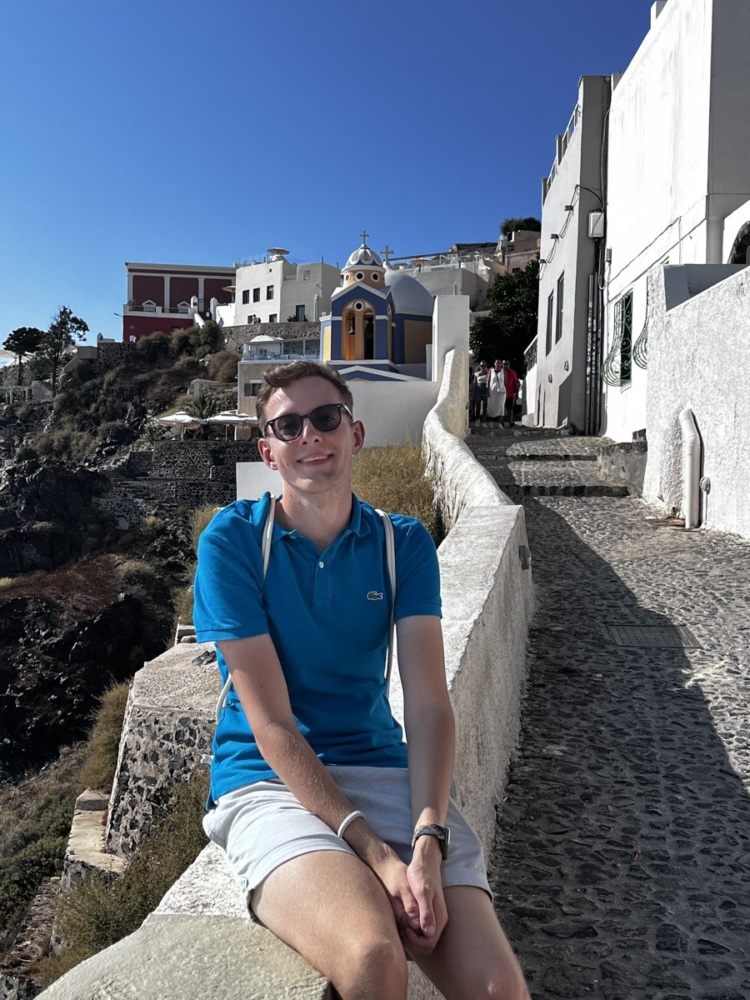

I am a Ph.D. candidate in economics at Ulm University, advised by Georg Gebhardt and Simeon Schudy.

I study how behavioral biases shape decisions with high stakes, from travelers' response to aircraft crashes to coaches' decisions under pressure and households' repayment of debt. My work combines natural experiments in administrative and market data with online experiments.

**Job Market Paper** 
[Stated Fear and Revealed Avoidance: Evidence from the Boeing 737 MAX Crashes](/publications/) 
After the first crash of the Boeing 737 MAX, travelers avoided airline-routes flown by the aircraft until it was grounded. The implied price of trust is about thirty dollars per ticket, and the perceived risk far exceeded the regulator's estimate, yet travelers avoided the aircraft far less than they said they would.
{: .notice}

## Beyond research

When I am not working on papers, I am often on the road. I have visited more than 40 countries so far, and I enjoy flying almost as much as I enjoy studying airlines. Football is the other constant, in my research and as a fan. In Ulm, I chair the Börsenforum Ulm e.V., the student finance association of Ulm University.
