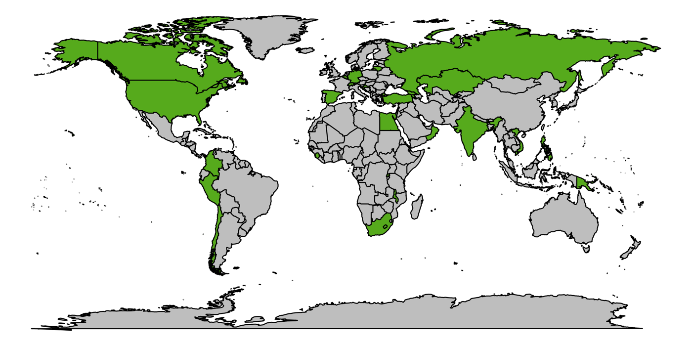
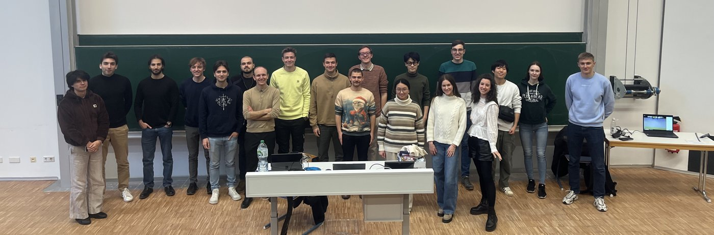



The **Ulm Laboratory for Microeconomics and Applied Economics (ULMA)** brings students from around the world together with applied economics at Ulm University. It started in 2024 with the first ULMA Economic Olympiad, originally under the name Ultimate League for Mastery in Applied Economics, and has grown into a set of formats that share four principles: empirical rigour, reproducibility, international collaboration and talent development. I co-founded ULMA together with Simon Maier.

## ULMA Economic Olympiad

The Economic Olympiad is an annual competition for Bachelor, Master and Ph.D. students in economics. Participants take a written exam of 100 minutes in microeconomics, macroeconomics, econometrics and finance, either on campus in Ulm or online. Participation is free.

* **2024:** 84 participants from 25 countries and 31 universities
* **2025:** 73 participants from 23 countries and 30 universities
* **2026:** 80 participants from 27 countries and 38 universities, for the first time with a three-day programme on campus, including a keynote, a visit to the Ulm laboratory for economic experiments, a session on AI agents in economics and an award dinner

*Countries of the participants in 2026.*

*Participants on campus at the first Economic Olympiad, December 2024.*

More information: [ULMA Economic Olympiad at Ulm University](https://www.uni-ulm.de/en/mawi/mawi-wiwi/forschung-und-lehre/ulma-economic-olympiad/)

## ULMA Economic Workshop

The Economic Workshop teaches empirical methods through actual empirical work. Partner universities nominate Master and Ph.D. students, who prepare online, attend a three-day training on site and then replicate and extend a published study together with students of the Ulm Master seminar Applied Data Science.

* **Partner universities 2026/27:** University of Zululand and University of South Africa (UNISA), South Africa, and University of Malta
* **On-site training:** South Africa in September 2026, Malta in October 2026
* **Participants:** 20 Master and Ph.D. students
* **Topics:** R and reproducible workflows with Git and Docker, AI agents, data preparation, regression, confounders and controls, panel data and fixed effects, randomised controlled trials and difference-in-differences

## Teaching

ULMA is also part of the curriculum at Ulm University, through the key skills module *ULMA – Applied Economics, International Exchange and Reflection* and the Master seminar *Applied Data Science: Replication and Extension*.

## Funding and Recognition

* Global Teaching Labs grants of Ulm University, EUR 20,000 for the Economic Olympiad and EUR 19,250 for the Economic Workshop (2026)
* Teaching project funding of Ulm University and the WiMa Foundation (2024 to 2026)
* Teaching Bonus in Economics 2025 of Ulm University for the ULMA Economic Olympiad

## Team

* **Economic Olympiad:** Luca Cermak, Simon Maier and Christoph Kiesl
* **Economic Workshop:** Luca Cermak, Simon Maier, Philipp Klotz, Alexander Rieber and Dennis Steinle
